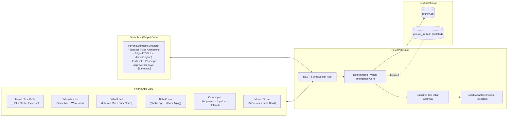

# Munim (मुनीम) — Voice-First AI Business Partner for Paytm Merchants

Built for Paytm's Hackathon Theme:  
**"Build the AI business partner for every Paytm merchant."**

Default Hero Persona: **Sharma Chai & Snacks**, Jaipur, Rajasthan.

---

## 🌟 Executive Summary

Over 30 million small Indian merchants have a Paytm Soundbox on their billing counter. Today, the Soundbox is passive: it only chirps after money has been received.

**Munim** transforms this device into an active, voice-first business partner. It:
1. **Infers the Product Mix Without POS Data**: Recovers the merchant's menu from bare UPI payment numbers using modal clustering and constrained combination search. Confirmed guesses update Bayesian priors in real time.
2. **Senses Footfall Rushes & Lulls**: Uses payment velocity against hour-of-week baselines. Surges ($Z > 2.0$) trigger Soundbox prep alerts; lulls trigger targeted flash offers.
3. **Automates Bahi-Khata & Udhaar Copilot**: Voice logs daily cash collections and expenses, and generates polite 3-tone payment reminders (Soft, Firm, Funny) via simulated UPI Collect.
4. **Enforces Strict Guardrails with Zero Bypass**: Tier 0 read and Tier 1 drafts execute automatically; Tier 2 actions that message customers or spend money require explicit merchant approval on the phone app. Adapters are protected by an internal authorization token.
5. **Measures Counterfactual Campaign Uplift**: Evaluates approved campaigns against an 80/20 holdout group, reporting simulated incremental revenue and honest confidence intervals.
6. **Computes Transparent Munim Score (0–100)**: A 5-factor creditworthiness signal that unlocks indicative working capital loan bands with full underwriting disclaimers.

---

## 🔒 Strict Honesty & Simulation Disclosure

> [!IMPORTANT]
> - **All Data is Synthetic**: No real Paytm APIs exist for this prototype. Every external action (Soundbox broadcast, UPI Collect link, SMS offer) is a mocked adapter behind an interface, logging what would have been sent.
> - **Visible Simulated Badges**: All counterfactual uplift figures, Soundbox device mockups, and score-to-limit bands carry a prominent `Simulated` tag in the UI and data models.
> - **Zero Arithmetic in LLM**: The AI assistant **never** calculates or invents numbers. All metrics, margins, and financial totals are calculated strictly by deterministic Python functions.
> - **Underwriting Disclaimer**: *"Munim Score is an illustrative signal for Paytm's existing underwriting, not a credit decision."*
> - **Ground-Truth Isolation**: The ground-truth menu is stored in a separate database (`ground_truth.db`). Inference code and agent tools have zero access to this table; isolation is validated via automated AST scanning tests.

---

## 🏗️ System Architecture



---

## 🚀 Quickstart & One-Command Run

### Prerequisites
- **Python 3.11** (Pinned: `>=3.11, <3.12` — see `.python-version` and `pyproject.toml`)
- **Node.js v20+** and **npm**

### 1. Setup & Installation
```bash
# Clone or navigate to the repository
cd munim

# Install backend dependencies
pip install -r backend/requirements.txt

# Install frontend dependencies
cd frontend && npm install && cd ..
```

### 2. Seed Synthetic Data (9 Months, 6 Merchants, Fixed RNG Seed)
```bash
python -m backend.app.sim.seed
```
*Seeds 81,273 transactions with 6 planted hero stories across `munim.db` and `ground_truth.db`.*

### 3. Run the Full-Stack Application
```bash
# Build the frontend assets
cd frontend && npm run build && cd ..

# Launch the unified FastAPI application (serves API, WebSockets, and Frontend SPA)
python -m uvicorn backend.app.main:app --host 0.0.0.0 --port 8000
```
Open your browser at **[http://localhost:8000](http://localhost:8000)**.

Alternatively, with Docker:
```bash
docker-compose up --build
```

---

## 🧪 Test Suite & Evaluation Benchmark

Run all 31 backend tests:
```bash
python -m pytest backend/tests/ -v
```

### Test Suite Summary:
- `test_phase1_generator.py`: Verifies all 6 merchants, ground truth isolation, and 6 planted hero stories (Tuesday 2-5 PM dead slot, 25 churned regulars, high-margin evening undersell, weekend 5-8 PM rush, settlement delay gap, 8 udhaar records with 2 overdue > 15 days).
- `test_phase2_inference_and_opportunities.py`: Verifies deterministic daily summary (`UPI + Cash - Expense`), Bayesian prior updating, footfall rush detection ($Z > 2.0$), 6 opportunity detectors, and weather dip suppression.
- `test_phase3_agent_and_guardrails.py`: Verifies zero-math agent execution, Tier 0/1/2 guardrails, budget limits, idempotency deduplication, and end-to-end campaign-to-uplift journey.
- `test_phase4_voice_and_bahi_khata.py`: Verifies Hinglish voice number parser, Udhaar aging, 3-tone reminders, 5-factor Munim score, and morning brief.
- `test_isolation.py`: Audits that inference code never imports or queries ground truth, proves that direct adapter calls without tokens fail with `PermissionError`, and proves unapproved Tier 2 actions never touch adapters.
- `test_api_endpoints.py`: Verifies all FastAPI REST endpoints.

### Benchmark Results (`data/eval_results.json`):
- **Item Inference F1 Score**: `1.0` (Target $\ge 0.75$ MET across all 6 merchants)
- **50-Question QA Tool Selection Accuracy**: `88.0%`
- **Zero-Math Hallucination Safety**: `100.0%`
- **30-Phrase Hinglish Voice Extraction Accuracy**: `90.0%`

---

## 📱 Hardware & UI Layout (Split View)

- **Soundbox Simulator (Left)**:
  - Output-only physical device mockup with animated cyan speaker rings.
  - Edge-TTS neural speech playback (`hi-IN-MadhurNeural`).
  - Caption displays what was announced; when decisions are required, ends with: *"Phone pe approve kar dijiye"*.
  - No mic or buttons on the device.
- **Phone App View (Right)**:
  - **Home Screen**: True Daily Profit, Munim Score circular gauge, Morning Brief, and Top Growth Opportunity with quick Approve / Skip.
  - **Talk to Munim**: Voice-first chat with microphone input, audio waveform animation, and inline action approval cards.
  - **What I Sell**: Inferred product mix bar chart with interactive Bayesian confirmation chips ("₹20 = Samosa, sahi?").
  - **Bahi-Khata**: Daily cash/expense logger, structured voice confirmation, Udhaar ledger with aging tiers, and 3-tone reminder modal.
  - **Campaigns**: Approvals queue for Tier 2 actions, active campaigns, Uplift vs Holdout simulation chart, and immutable audit log.
  - **Munim Score**: 5-factor breakdown (Consistency 25, Growth 20, Repeat 20, Udhaar 20, Cash 15), actionable advice, and indicative loan band.
  - **Demo Control Panel Modal**: Instant 16-payment burst injection, merchant archetype switcher, and reseeding.
  - **Eval Dashboard Modal**: Benchmark accuracy metrics and merchant inference matrix.

---

## 📄 License & Hackathon Notice

Developed for the Paytm AI Partner Hackathon. All merchant names, customer identities, and financial transactions are purely synthetic simulations created for demonstration purposes.
