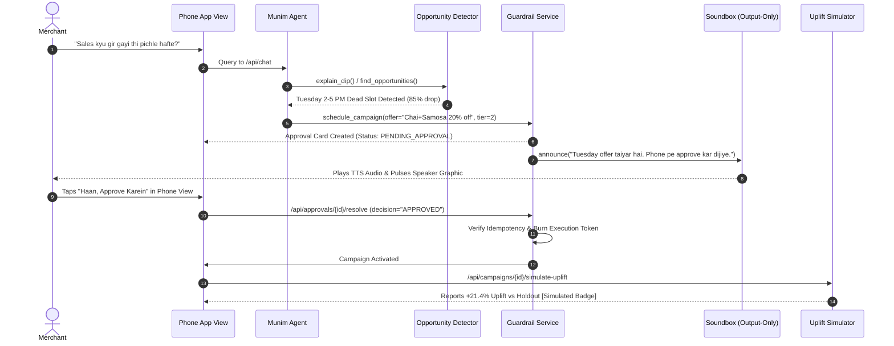

# Munim System Architecture

"Munim" is an agentic AI business partner for small Indian merchants on Paytm. It connects raw UPI payment streams with a simulated physical Paytm Soundbox and a mobile-first merchant copilot.

---

## High-Level Architecture Diagram

```mermaid
graph TB
    subgraph Channels ["Merchant Interface & Hardware Layer"]
        SB["Simulated Paytm Soundbox (Output-Only)\n- Pulsing Speaker Animation\n- Edge-TTS Voice Audio (hi-IN-MadhurNeural)\n- Captions ending with: 'Phone pe approve kar dijiye'\n- [Simulated Badge]"]
        Phone["Mobile-First Phone App View\n- Home: Daily Profit (UPI + Cash - Expense)\n- Talk to Munim: Voice Mic + Hinglish Waveform\n- What I Sell: Inferred Mix + Prior Confirmations\n- Bahi-Khata: Voice Cash Logger + Udhaar Ledger\n- Campaigns: Tier 2 Approvals + Uplift vs Holdout\n- Score: 5 Factors + Loan Limit Band"]
    end

    subgraph Gateway ["API & Real-Time Gateway"]
        FastAPI["FastAPI REST Engine\n(/api/merchants, /api/summary, /api/udhaar, etc.)"]
        WS["WebSocket Live Hub\n(/ws/live/{merchant_id})"]
    end

    subgraph Guardrails ["Security & Governance Layer (Zero Bypass)"]
        Guard["Guardrail Tier Enforcement Engine\n- Tier 0: Read & Analyze (Auto)\n- Tier 1: Drafts (Auto-created, unblocked)\n- Tier 2: Customer messages & money spend (Approval Required)\n- Budget Cap Check (Max ₹2,000)\n- Idempotency Deduplication Key"]
        Audit["Immutable Audit Log\n(actor, action, tier, payload, idempotency_key, timestamp)"]
        AuthToken["Internal Execution Token\n(Private runtime authorization token held ONLY by GuardrailService)"]
    end

    subgraph Adapters ["Simulated External Adapters (Mock Layer)"]
        MockSB["MockSoundboxAdapter\n- announce(merchant_id, text, audio)\n- [Strictly Output-Only; No listen/mic/reply]"]
        MockUPI["MockUPICollectAdapter\n- send_collect_request(customer, amount, msg)"]
        MockMsg["MockMessagingAdapter\n- send_campaign_offer(campaign, recipients, text)"]
    end

    subgraph Brain ["Deterministic Intelligence Core"]
        Metrics["MetricsService\n(Deterministic UPI + Cash - Expense = Net Profit)"]
        ItemInf["ItemInferenceService\n- GMM Price Point Clustering\n- Combinatorial Subset Decomposition\n- Bayesian Prior Updates"]
        Footfall["FootfallSensor\n- Hourly Baseline (Mean & Std Dev)\n- Z-score > 2 Rush & Lull Detector\n- Anti-Spam Rate Limit Cooldowns"]
        Opps["OpportunityService\n- 6 Planted & Rule-Based Signals\n- Weather/Match 'Don't Act' Filter"]
        Udhaar["UdhaarService\n- Aging Tiers (0-7, 8-14, 15+ Overdue)\n- 3-Tone Reminders (Soft, Firm, Funny)"]
        Score["MunimScoreService\n- 5-Factor Weighted Credit Formula (0-100)\n- Indicative Limit Band\n- Underwriting Disclaimer"]
        VoicePipe["Voice Pipeline\n- Hinglish Speech & Number Extractor\n- Edge-TTS Neural Audio Synthesizer"]
        UpliftSim["Counterfactual Uplift Simulator\n- 80/20 Treatment vs Holdout\n- CustomerResponseEngine"]
    end

    subgraph Storage ["Isolated Persistence Layer"]
        MainDB[("munim.db (SQLite / PostgreSQL-ready)\nMerchants, Customers, Transactions, Hypotheses,\nCashLogs, Expenses, Udhaar, Campaigns, Approvals")]
        GTDB[("ground_truth.db (Strictly Isolated SQLite)\nmenu_items_truth: Never accessible to inference code")]
    end

    Channels <-->|REST + Live WS| Gateway
    Gateway --> Brain
    Brain --> Guard
    Guard -->|Requires Private Token| Adapters
    Guard --> Audit
    Brain --> MainDB
    Brain -. Ground Truth Read Strictly Forbidden .- GTDB
```

---

## Data Flow: End-to-End Campaign Flow

---

## Real vs Simulated Transparency Matrix

| Component / Feature | Real / Production Ready | Simulated / Mocked | Reason & Safety Guarantee |
|:---|:---:|:---:|:---|
| **Deterministic Metrics** | ✅ Real Python | — | Zero arithmetic in LLM; calculated strictly from transactions, cash logs, and expenses. |
| **Item Inference & Bayesian Priors** | ✅ Real Algorithmic | — | Frequency clustering + combinatorial decomposition; priors update to 1.0 upon merchant confirmation. |
| **Ground Truth Menu Isolation** | ✅ Real Security Boundary | — | `menu_items_truth` stored in isolated `ground_truth.db`; audited via AST scanner tests. |
| **Guardrail Tiers & Adapter Token** | ✅ Real Security Gateway | — | Private runtime authorization token prevents direct adapter bypass; audits all actions. |
| **Hinglish Voice Parsing** | ✅ Real Parser | — | Parses spoken Hindi words ("teen hazaar do sau" $\to$ 3200) into structured entries. |
| **Edge-TTS Audio Synthesis** | ✅ Real Audio Engine | — | Microsoft Edge Neural voices (`hi-IN-MadhurNeural`) saved locally as MP3 files. |
| **Paytm Soundbox Hardware** | — | 🟡 Simulated Device | Simulated as browser audio visualizer; marked with visible "Simulated" badge. |
| **UPI Collect Requests** | — | 🟡 Mock Adapter | Logs simulated payment links that would be sent to debtor phone. |
| **SMS / WhatsApp Messaging** | — | 🟡 Mock Adapter | Logs simulated customer campaign outreach. |
| **Campaign Uplift vs Holdout** | — | 🟡 Counterfactual Model | Simulates customer redemption probabilities based on discount, time, and visits. |
| **Munim Score to Limit Band** | — | 🟡 Indicative Signal | Labeled explicitly: *"Illustrative signal for Paytm's existing underwriting, not a credit decision."* |
